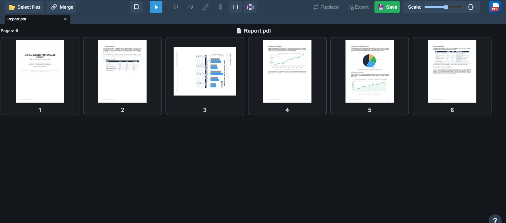
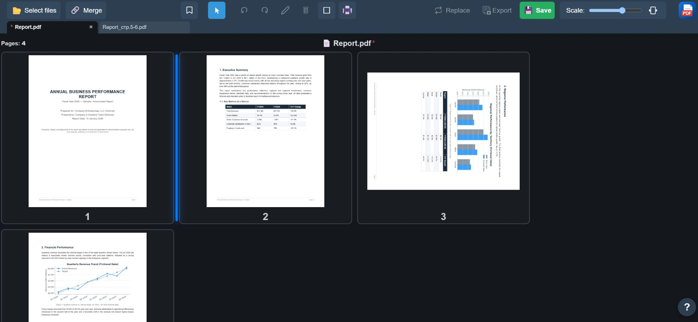
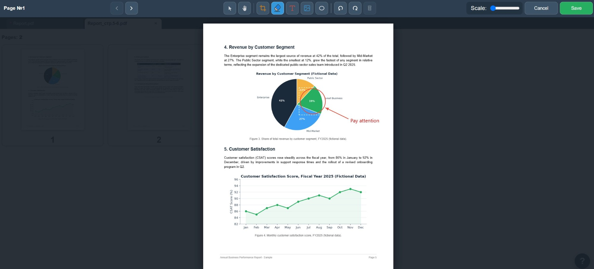
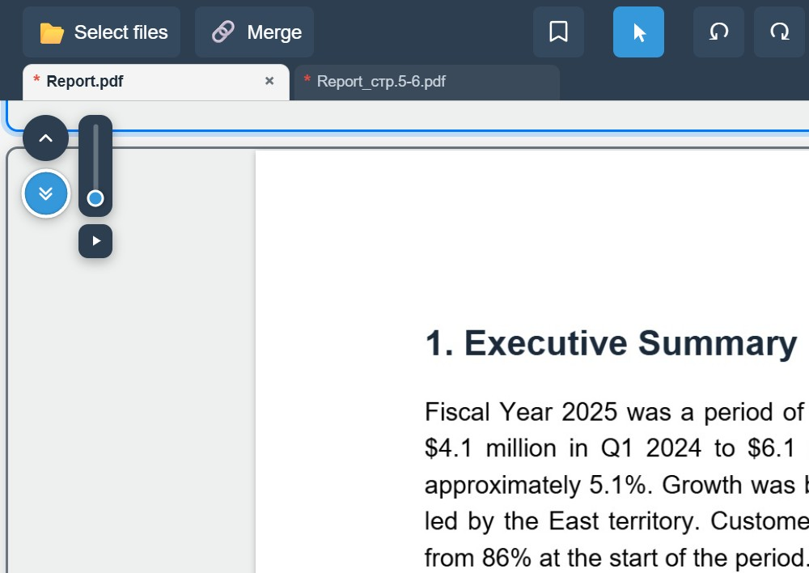
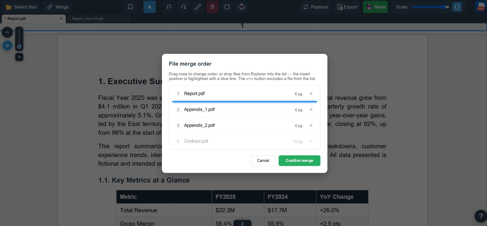
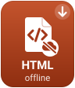
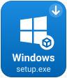
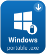

# PDF Document Manager in a <b>single HTML file</b>

  <a href="#english">🇬🇧 English</a> · <a href="#русский">🇷🇺 Русский</a>

**A PDF editor that runs entirely in your browser.** Merge and split PDFs, edit pages, manage bookmarks, convert Word/Excel/email files — all in a single HTML file, nothing to install. Your files never leave your computer: everything happens locally, nothing is uploaded to a server.

<table>
<tr>
<td align="center" width="20%">
 
Page thumbnails
</td>
<td align="center" width="20%">
 
Tabs & splitting pages
</td>
<td align="center" width="20%">
 
Page editor — shapes, arrows & text
</td>
<td align="center" width="20%">
 
Floating scroll navigator
</td>
<td align="center" width="20%">
 
Merging in a custom order
</td>
</tr>
</table>

*(click a thumbnail to open it full-size)*

### Download

&emsp;

&emsp;

&emsp;

*Click an icon to download the file (WEB opens the editor online); hover over it for a description.*

Release pages: [Windows](https://github.com/65WebDev/PDF-Manager/releases/tag/windows-v0.1.50) · [Linux](https://github.com/65WebDev/PDF-Manager/releases/tag/linux-v0.1.50) · [Android](https://github.com/65WebDev/PDF-Manager/releases/tag/android-v0.1.50)

After downloading, open the HTML file in your browser. The online version loads its libraries from a CDN; the offline version bundles everything inside the file and works without internet access.

Supported browsers: Chrome/Edge 125+, Firefox ESR, Safari 18+ (including iOS/iPadOS 18+).

Android app: Android 7.0+, phones and tablets. Open the downloaded `.apk` on the phone; if Android warns about an app from an unknown developer, choose “Install anyway”.

### Features

- **Page management** — merge, split, drag to reorder, delete and rotate pages.
- **Built-in page editor** — add and edit text and images directly on a PDF page.
- **Bookmarks & table of contents** — hierarchical bookmarks with multi-select, drag reordering, and bulk delete.
- **Clickable internal links** — follow links and table-of-contents entries in the viewer.
- **Smart zoom** — crisp rendering at any zoom level, snaps to page width (wheel/slider on desktop, pinch-to-zoom on mobile).
- **Multiple documents at once** — several PDFs in tabs, one window (up to 6 on a phone).
- **Import from Word, Excel & email** — `.docx`, `.xlsx`, `.eml` and `.msg` converted to PDF automatically.
- **Image compression** — reduce the PDF file size without losing readability.
- **Password & encryption** — set a password on a PDF right in the browser, no third-party service involved.

**Supported interface languages:** English, Russian, Spanish, Chinese.

**Embedded libraries:**

- **pdf-lib** v1.17.1 — PDF assembly and editing (pages, rotation, merging, saving)
- **pdf.js** v6.3.289 — rendering PDF pages (thumbnails, preview)
- **mammoth** v1.12.3 — converting Word (`.docx`) files to HTML on import
- **SheetJS (xlsx)** v0.20.3 — reading Excel (`.xls`/`.xlsx`) tables on import
- **html2canvas** v1.4.1 — rasterizing HTML markup into an image for PDF assembly
- **JSZip** v3.10.2 — unpacking `.docx` archives for docx-preview
- **docx-preview** v0.4.1 — page-accurate rendering of Word documents
- **ExcelJS** v4.4.0 — reading styled Excel tables with print/pagination settings
- **postal-mime** v3.0.1 — parsing email messages (`.eml`)
- **@kenjiuno/msgreader-web-ng** v0.2.0-alpha1 — parsing Outlook messages (`.msg`)
- **@kenjiuno/decompressrtf** v0.1.4 — decompressing RTF bodies inside `.msg` files
- **@cantoo/pdf-lib** v2.11.1 — opening password-protected PDFs
- **@pdf-lib/fontkit** v1.1.1 — embedding a Unicode font for non-Latin text in filled-in form fields

---

**Редактор PDF, который работает прямо в браузере.** Объединение и разделение PDF, редактирование страниц, закладки, конвертация файлов Word, Excel и писем — всё в одном HTML-файле, ничего устанавливать не нужно. Файлы не покидают ваш компьютер: вся обработка происходит локально, на сервер ничего не загружается.

<table>
<tr>
<td align="center" width="20%">
 
Миниатюры страниц
</td>
<td align="center" width="20%">
 
Вкладки и перенос страниц
</td>
<td align="center" width="20%">
 
Редактор страниц — фигуры, стрелки, текст
</td>
<td align="center" width="20%">
 
Навигатор прокрутки
</td>
<td align="center" width="20%">
 
Объединение в нужном порядке
</td>
</tr>
</table>

*(нажмите на миниатюру, чтобы открыть в полном размере)*

### Скачать

&emsp;

&emsp;

&emsp;

*Нажмите на иконку, чтобы скачать файл (WEB открывает редактор онлайн); при наведении появится пояснение.*

Страницы релизов: [Windows](https://github.com/65WebDev/PDF-Manager/releases/tag/windows-v0.1.50) · [Linux](https://github.com/65WebDev/PDF-Manager/releases/tag/linux-v0.1.50) · [Android](https://github.com/65WebDev/PDF-Manager/releases/tag/android-v0.1.50)

После скачивания откройте HTML-файл в браузере. Онлайн-версия подгружает библиотеки из CDN; офлайн-версия содержит все библиотеки внутри файла и работает без интернета.

Поддерживаемые браузеры: Chrome/Edge 125+, Firefox ESR, Safari 18+ (в том числе iOS/iPadOS 18+).

Приложение для Android: Android 7.0+, телефоны и планшеты. Откройте скачанный `.apk` на телефоне; если Android предупредит о приложении от неизвестного разработчика, выберите «Всё равно установить».

### Возможности

- **Управление страницами** — объединение и разделение файлов, перестановка перетаскиванием, удаление и поворот страниц.
- **Встроенный редактор страниц** — добавление и редактирование текста и изображений прямо на странице PDF.
- **Закладки и оглавление** — многоуровневые закладки: выделение нескольких сразу, перестановка перетаскиванием, удаление группой.
- **Внутренние ссылки** — переходы по ссылкам и оглавлению прямо в просмотре.
- **Удобное масштабирование** — чёткое изображение при любом масштабе, привязка к ширине страницы (колесо мыши или ползунок на компьютере, жест двумя пальцами на смартфоне).
- **Несколько документов сразу** — несколько PDF во вкладках одного окна (на смартфоне — до 6).
- **Импорт из Word, Excel и почты** — `.docx`, `.xlsx`, `.eml` и `.msg` конвертируются в PDF автоматически.
- **Сжатие изображений** — уменьшение размера файла без потери читаемости.
- **Пароль и шифрование** — установка пароля на PDF прямо в браузере, без сторонних сервисов.

**Поддерживаемые языки интерфейса:** русский, английский, испанский, китайский.

**Используемые библиотеки:**

- **pdf-lib** v1.17.1 — сборка и редактирование PDF (страницы, поворот, объединение, сохранение)
- **pdf.js** v6.3.289 — отрисовка страниц PDF (миниатюры, просмотр)
- **mammoth** v1.12.3 — конвертация файлов Word (`.docx`) в HTML при импорте
- **SheetJS (xlsx)** v0.20.3 — чтение таблиц Excel (`.xls`/`.xlsx`) при импорте
- **html2canvas** v1.4.1 — растеризация HTML-разметки в изображение для сборки PDF
- **JSZip** v3.10.2 — распаковка `.docx`-архивов для docx-preview
- **docx-preview** v0.4.1 — постраничная отрисовка документов Word
- **ExcelJS** v4.4.0 — чтение таблиц Excel со стилями и настройками печати
- **postal-mime** v3.0.1 — разбор писем (`.eml`)
- **@kenjiuno/msgreader-web-ng** v0.2.0-alpha1 — разбор писем Outlook (`.msg`)
- **@kenjiuno/decompressrtf** v0.1.4 — распаковка текста писем в формате RTF внутри `.msg`
- **@cantoo/pdf-lib** v2.11.1 — открытие PDF-файлов, защищённых паролем
- **@pdf-lib/fontkit** v1.1.1 — встраивание Unicode-шрифта для нелатинского текста в заполняемых полях форм
